# DevOps Delivery Challenge — Project Evidence

This document collects screenshots demonstrating the project's CI/CD workflow, code-quality analysis, container publication, deployment, and running application.

## Project summary

The repository contains a Python application, automated tests, Docker configuration, Terraform infrastructure code, Ansible playbooks, and GitHub Actions workflows. The screenshots record visible results from the project environment at the time they were captured.

## Evidence

### GitHub Actions workflow runs

Shows successful CI and CD runs alongside earlier failed attempts.

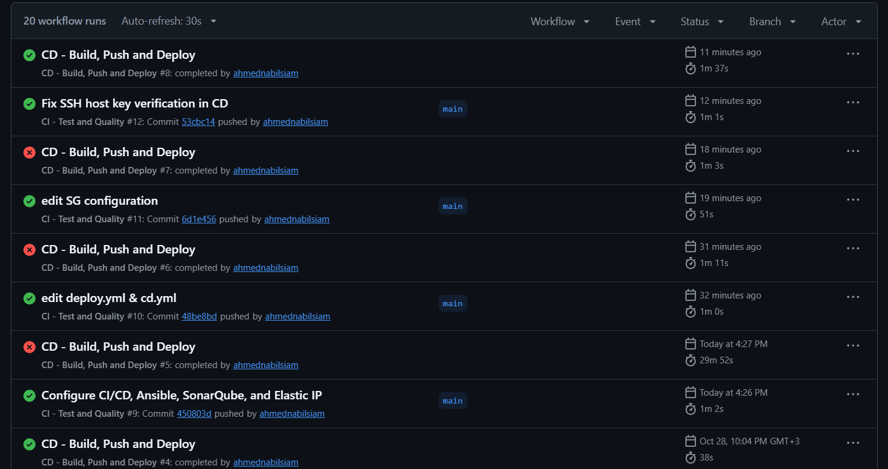

### SonarQube project overview

Shows the project overview and Quality Gate status: Passed.

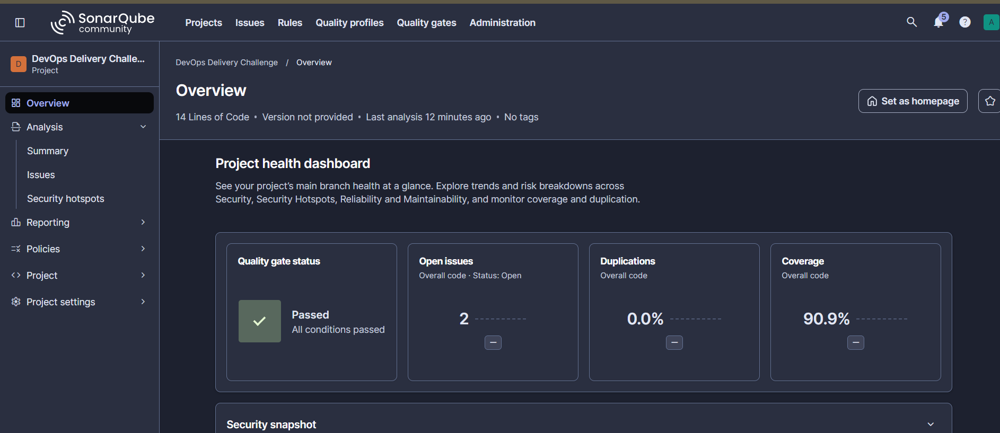

### CI workflow success

Shows Lint and Test followed by SonarQube Quality Gate.

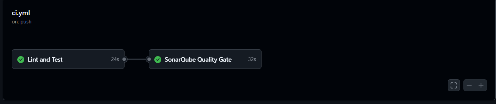

### CD build and publish summary

Shows a completed Docker image build and publication.

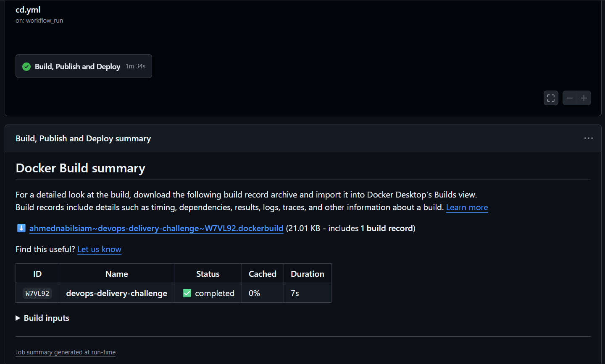

### CD deployment workflow

Shows successful build/publish, Ansible deployment, and health-check steps.

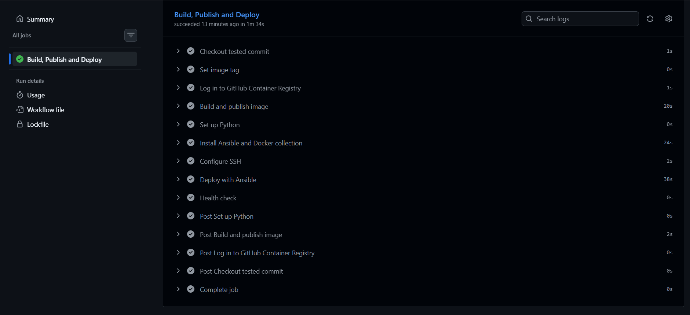

### SonarQube security dashboard

Shows security-related issue metrics identified by the analyzer.

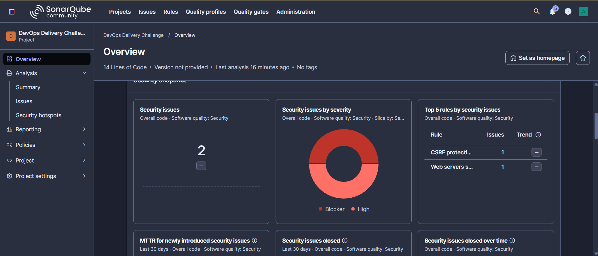

### SonarQube analysis summary

Shows Quality Gate Passed, 90.9% coverage, and 0.0% duplications.

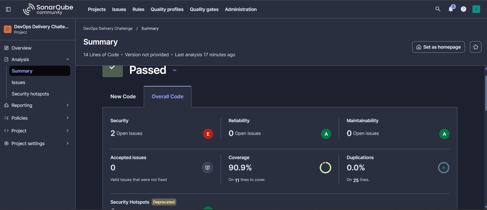

### GitHub Container Registry package tags

Shows the published container package and tagged image versions.

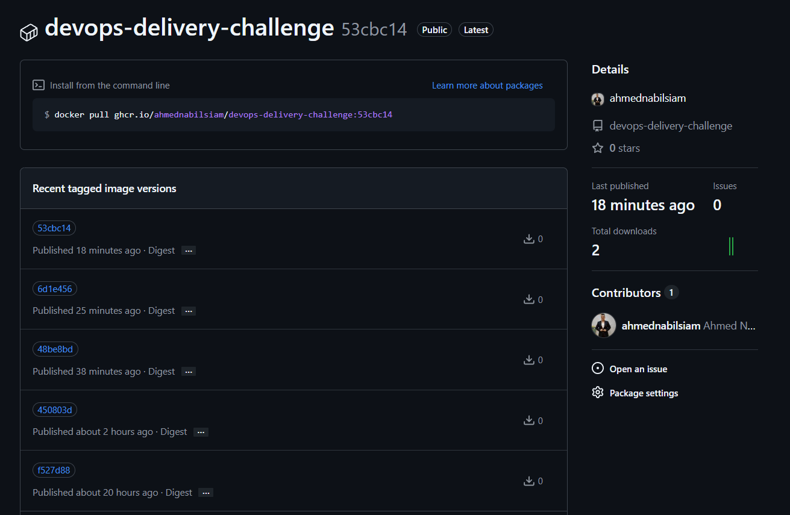

### Application root endpoint

Shows the application name and version returned by the service.

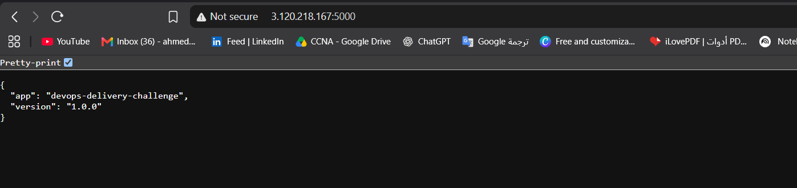

### Application health endpoint

Shows the health endpoint returning status healthy.

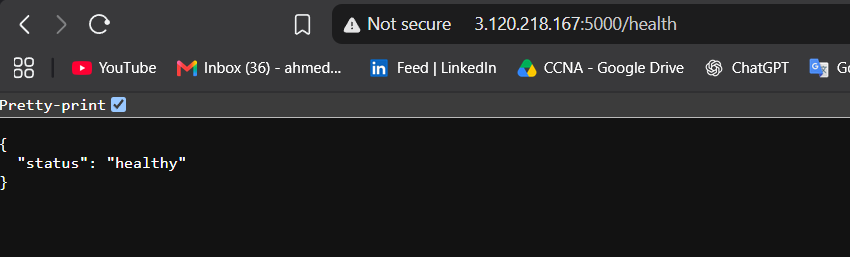

### AWS EC2 instance

Shows the EC2 instance used to host the project.

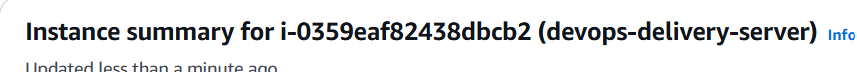

### EC2 security group

Shows the security group associated with the EC2 server.

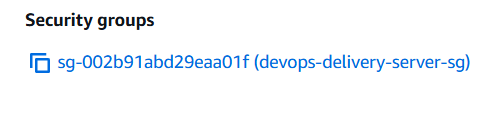

### Repository project structure

Shows the main folders and configuration files in the project.

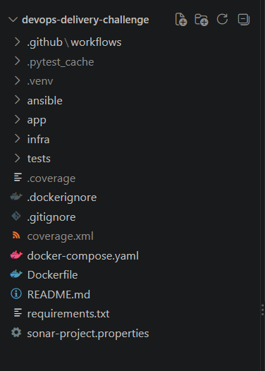

## Notes

- The CI screenshot shows **Lint and Test** followed by **SonarQube Quality Gate**.
- The CD screenshot shows **Build, Publish and Deploy** completing successfully, including Ansible deployment and health-check steps.
- The SonarQube screenshots show a passed Quality Gate and 90.9% coverage at capture time.
- The application endpoints return the expected metadata and `healthy` status.
- Screenshots document the captured run and environment; they do not guarantee cloud resources remain running.
- Review screenshots for account identifiers or information you do not want to disclose before sharing publicly.
